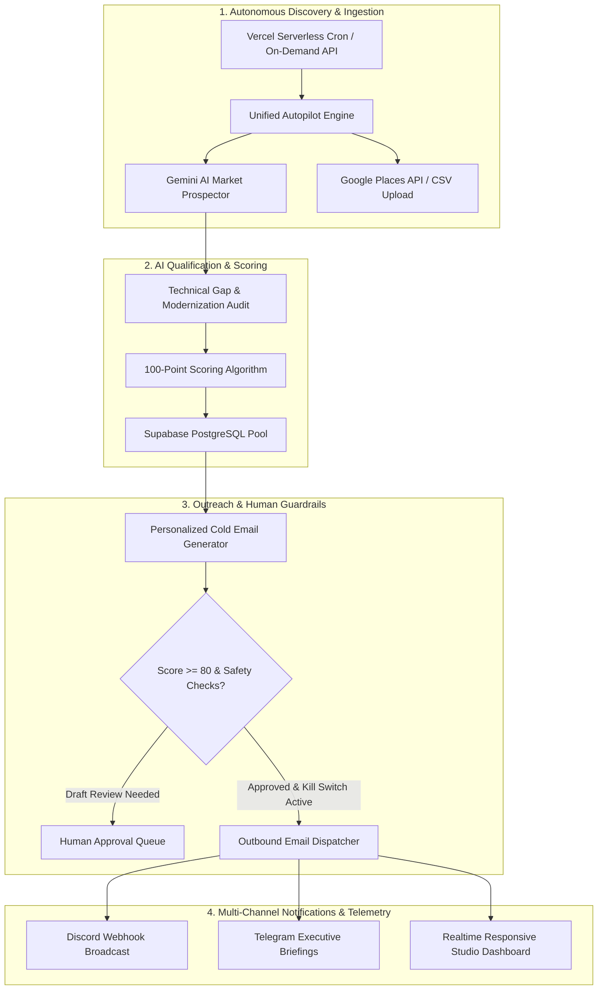

# Queenstown Labs — Lead Intelligence & Acquisition Platform

> Autonomous B2B Prospect Discovery, Gemini AI Qualification, Outbound Sales & Discord Telemetry Engine for **[Queenstown Labs](https://queenstown-labs-web.vercel.app/)**


---

## 🔗 Quick Links

- **Live Production Dashboard**: [https://queenstownlabslead.vercel.app/](https://queenstownlabslead.vercel.app/)
- **Queenstown Labs Official Studio Website**: [https://queenstown-labs-web.vercel.app/](https://queenstown-labs-web.vercel.app/)
- **GitHub Repository**: [https://github.com/ByteLounge/QS-Lead-Intelligence](https://github.com/ByteLounge/QS-Lead-Intelligence)

---

## 1. Executive Summary

**Queenstown Lead Intelligence** is the automated, cloud-native client acquisition, qualification, and outbound outreach engine of **Queenstown Labs**—a modern software design and engineering studio based in Goa, India, specializing in web applications, mobile software, SaaS platforms, and operational AI.

The dashboard interface is crafted to mirror the Swiss minimalist aesthetic, typography (`Inter` / `Inter Tight`), hairline borders, and glassmorphic micro-surfaces of Queenstown Labs' official startup website.

The platform executes the full client acquisition lifecycle autonomously 24/7 on **Vercel Serverless** and **Supabase PostgreSQL** without requiring self-hosted runners or heavy infrastructure:

1. **Autonomous Discovery**: AI engine continuously scans target markets (India, UAE, UK, Singapore, Australia) for businesses that lack modern websites, mobile apps, or digital customer portals.
2. **Technical Gap Analysis**: Evaluates digital maturity, pinpoints missing infrastructure (e.g. absent mobile experience, slow legacy website, manual ordering), and determines exact studio modernization recommendations.
3. **100-Point Qualification Scoring**: Multi-dimensional scoring across Industry Relevance (25), Software Opportunity (25), Business Suitability (20), Evidence Quality (15), and Contact Reachability (15).
4. **Tailored Outreach Generation**: Drafts concise 80–130 word B2B cold emails tailored to each company's verified operational gaps.
5. **Human-in-the-Loop Safety Approvals**: Mandatory approval queue, global sending kill switch, and strict daily volume limits ensure zero spam.
6. **Multi-Channel Telemetry**: Instant alerts sent to Discord webhooks and Telegram for every new lead discovered, email dispatched, and inbound reply received.
7. **CRM Pipeline & Kanban**: 13-stage B2B deal pipeline tracking accounts from Discovery to Closed-Won ($329,000+ active commercial pipeline).
8. **Fully Responsive Across All Devices**: Native experience across mobile phones (320px–480px), tablets (768px–1024px), laptops, and large desktop screens.

---

## 2. System Architecture



---

## 3. Key Platform Capabilities

### ⚡ Unified AI Autopilot Engine
- Fast, single-cycle autonomous discovery implemented in [`lib/discovery/autopilot.ts`](file:///D:/Projects/QS-Lead-Intelligence/lib/discovery/autopilot.ts) completing in **~4 seconds** (optimized to eliminate Vercel serverless gateway timeouts).
- Analyzes prospects for high-value software opportunities: mobile customer apps, booking/catalog portals, internal dashboards, and workflow automation.
- Automatically saves new companies, leads, and outreach drafts into Supabase with automatic deduplication.

### 📱 Responsive Multi-Device UI
- **Mobile Drawer Navigation**: Slide-out mobile drawer with backdrop blur overlay and accessibility close handler for `< lg` viewports.
- **Adaptive TopBar**: Mobile hamburger toggle, condensed status pills (`SENDING: ACTIVE` / `KILL SWITCH: BLOCKED`), and flexible icon-first actions.
- **Fluid KPI Grid**: Re-scaling metric cards (`grid-cols-2 sm:grid-cols-3 md:grid-cols-4 lg:grid-cols-5`) and Recharts containers with responsive safe margins.
- **Horizontal Scroll Protection**: Touch-scrollable table containers across `/companies`, `/leads`, `/opportunities`, `/inbox`, `/email-approvals`, and `/settings`.

### 🛡️ Outbound Safety & Compliance Guardrails
- **Global Sending Kill Switch**: Immediate cessation of all outbound emails when toggled.
- **Deterministic Suppression**: Automatic one-click opt-out and unsubscribe processing.
- **Human-in-the-Loop Review**: Mandatory operator approval queue before any cold email is transmitted.
- **Daily Volume Caps**: Strict pacing per mailbox to protect domain deliverability and sender reputation.

### 🔔 Discord & Telegram Telemetry
- **Discord Webhook**: Delivers rich embeds with company names, industry, website gap analysis, score ratings, and outreach status directly to team channels.
- **Telegram Bot**: Daily executive digest summarizing new leads, pipeline growth, and reply intent.

---

## 4. API Endpoints & Autonomous Routes

| Method | Endpoint | Description | Schedule / Trigger |
|---|---|---|---|
| `POST` | `/api/autonomous/run` | Triggers a full AI discovery and outreach cycle | On-demand button / webhook |
| `GET` | `/api/cron/discovery` | Daily automated discovery & AI lead qualification | Daily 06:00 UTC (Vercel Cron) |
| `GET` | `/api/cron/dispatch` | High-priority outreach dispatch queue | Every 15 min (cron-job.org) |
| `GET` | `/api/cron/digest` | Daily executive digest broadcast to Discord & Telegram | Daily 18:00 UTC (Vercel Cron) |
| `GET` | `/api/dashboard/metrics` | Real-time KPIs, charts data, and telemetry health | Realtime fetch |
| `GET/POST`| `/api/companies` | List, search, filter, and create target companies | On-demand |
| `GET/PATCH`| `/api/leads` | Leads qualification list and manual score overrides | On-demand |
| `POST` | `/api/outreach/approve` | Approve, edit, or reject pending outreach drafts | Operator action |
| `POST` | `/api/settings/discord` | Test and configure Discord Webhook alerts | Settings UI |

---

## 5. Technology Stack

- **Framework**: [Next.js 14](https://nextjs.org/) (App Router, Server Components & Route Handlers)
- **Language**: [TypeScript 5.6](https://www.typescriptlang.org/) (Strict type checking)
- **Styling**: [Tailwind CSS 3.4](https://tailwindcss.com/) & Custom Queenstown Studio Design System
- **Database**: [Supabase](https://supabase.com/) (PostgreSQL 15 with Row-Level Security)
- **AI Model**: [Google Gemini 2.5 Flash](https://ai.google.dev/) (Structured JSON schemas via Zod)
- **Visualization**: [Recharts](https://recharts.org/) (Responsive Bar, Line, and Pie charts)
- **Icons**: [Lucide React](https://lucide.dev/)
- **Testing**: [Vitest](https://vitest.dev/) (20 unit and integration tests)
- **Hosting**: [Vercel](https://vercel.com/) (Serverless edge deployment)

---

## 6. Directory Structure

```text
QS-Lead-Intelligence/
├── app/                              # Next.js App Router
│   ├── (auth)/login/                 # Studio operator login
│   ├── activities/                   # Audit log & activity stream
│   ├── analytics/                    # Market reach & conversion telemetry
│   ├── automations/                  # Cloud autopilot & pipeline triggers
│   ├── campaigns/                    # Outreach sequence management
│   ├── companies/                    # Target enterprise accounts directory
│   ├── contacts/                     # Verified stakeholders directory
│   ├── dashboard/                    # Core executive intelligence dashboard
│   ├── email-approvals/              # Human-in-the-loop review queue
│   ├── inbox/                        # Inbound reply intent classifier
│   ├── leads/                        # 100-point AI qualified leads
│   ├── opportunities/                # 13-stage CRM sales pipeline Kanban
│   ├── settings/                     # Compliance, integrations, team RBAC
│   └── api/                          # Serverless route handlers & cron endpoints
├── components/                       # UI & layout component library
│   ├── brand/                        # Queenstown Labs studio logo & marks
│   ├── layout/                       # Sidebar, TopNav, MobileNavContext
│   ├── leads/                        # Modals (Discovery, Create Company)
│   └── ui/                           # Primitive UI components (Badge, Button, Card, Modal)
├── lib/                              # Core application libraries & adapters
│   ├── discovery/                    # Autopilot engine & Places discovery
│   ├── notifications/                # Discord webhook & Telegram dispatchers
│   ├── ai/                           # Gemini prompt builders & output schemas
│   ├── compliance/                   # Sending safeguards & suppression lists
│   └── supabase/                     # Database client & connection pool
├── database/                         # PostgreSQL schema & migration files
├── tests/                            # Vitest unit & integration test suites
└── public/                           # Static assets & brand media
```

---

## 7. Getting Started Locally

### Prerequisites
- **Node.js**: v18.18+ or v20+
- **npm** or **pnpm**
- **Supabase Account**: A free Supabase PostgreSQL database

### 1. Clone & Install
```bash
git clone https://github.com/ByteLounge/QS-Lead-Intelligence.git
cd QS-Lead-Intelligence
npm install
```

### 2. Environment Setup
Copy the sample environment file:
```bash
cp .env.example .env.local
```

Configure the following variables in `.env.local`:
```ini
# Supabase Database
NEXT_PUBLIC_SUPABASE_URL=https://your-project.supabase.co
NEXT_PUBLIC_SUPABASE_ANON_KEY=your-supabase-anon-key
SUPABASE_SERVICE_ROLE_KEY=your-supabase-service-role-key

# Google Gemini AI
GEMINI_API_KEY=your-gemini-api-key
GEMINI_MODEL=gemini-2.5-flash

# Discord Alerts (Optional)
DISCORD_WEBHOOK_URL=https://discord.com/api/webhooks/...

# Vercel Cron Security
CRON_SECRET=your-secure-cron-secret
NEXT_PUBLIC_APP_URL=http://localhost:3000
```

### 3. Database Migration & Seed
Run migrations to set up tables, views, and functions:
```bash
# Execute via Supabase SQL Editor or migration runner
npm run migrate
```

To seed the real commercial pipeline dataset:
```bash
npm run seed:real
```

### 4. Run Development Server
```bash
npm run dev
```
Open [http://localhost:3000](http://localhost:3000) to view the dashboard.

---

## 8. Verification & Quality Gates

Run the test suite and type check before deploying:

```bash
# 1. TypeScript compilation check
npm run typecheck

# 2. Automated test suite (Vitest)
npm test

# 3. Next.js production build verification
npm run build
```

---

## 9. Production Deployment on Vercel

1. Push your repository to GitHub.
2. Import the project into **Vercel**.
3. Add the environment variables from `.env.local` into the Vercel project settings.
4. Deploy! Vercel will automatically build the Next.js app and register the daily cron job at `06:00 UTC`.

---

## 10. License

Proprietary — Built exclusively for **Queenstown Labs**. All rights reserved.
