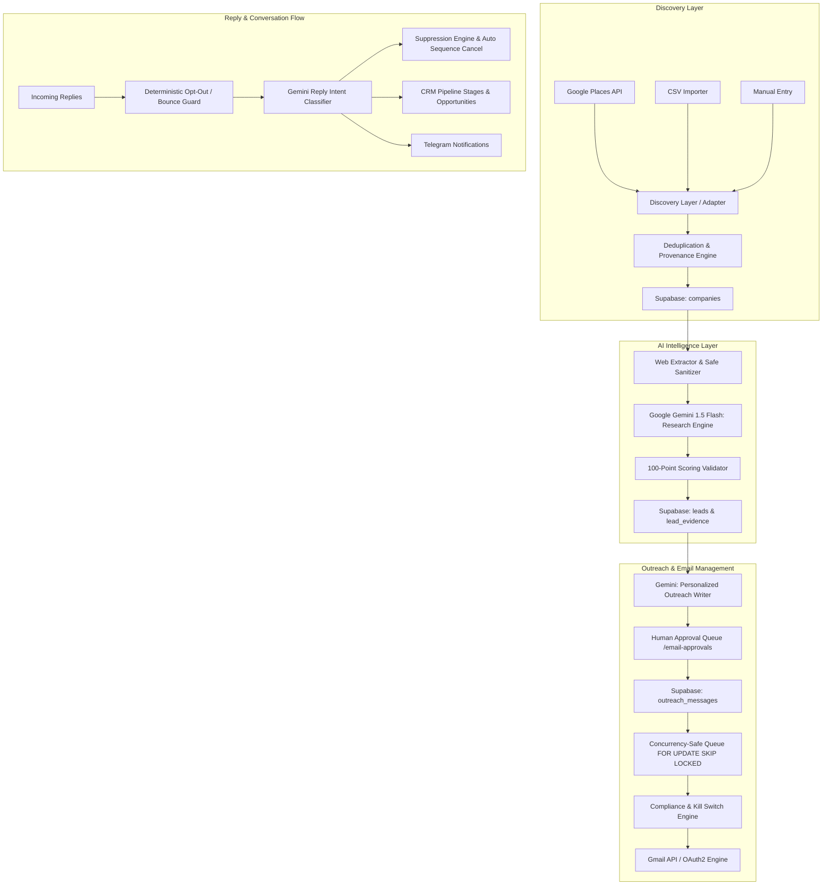

# Queenstown Lead Intelligence - System Architecture

## 1. Architectural Overview

**Queenstown Lead Intelligence** is an enterprise-grade AI-powered client acquisition and sales pipeline platform built specifically for **Queenstown Labs**—a custom software development agency.

The platform coordinates multi-source discovery, deep AI-powered technical intelligence, human-in-the-loop cold outreach, compliance-enforced email delivery, automated reply classification, and full CRM pipeline tracking.

## 2. Core Architectural Principles

1. **Safety and Compliance First**:
   - Outbound marketing email sending is guarded by a global `SENDING_ENABLED` kill switch (default: `false`).
   - Human approval is mandatory by default (`human_approval_required: true`).
   - Daily sending volume is capped at safe thresholds (default: 5 emails/day).
   - Inbound email replies and suppression checks operate independently and remain operational even if sending is killed.

2. **Strict Grounding & Anti-Hallucination**:
   - Scraped website content is treated as untrusted data and strictly sanitized.
   - AI outputs are constrained to facts verified from the target's public pages.
   - Clear distinction between "Verified Facts" and "Architectural Inferences/Hypotheses".

3. **Concurrency-Safe Queue Processing**:
   - Email dispatch queries use PostgreSQL `SELECT ... FOR UPDATE SKIP LOCKED` inside a transaction to prevent double-sends across concurrent workers.

4. **Modular Service Adapters**:
   - Discovery, LLM inference, email transport, and notification layers are isolated behind TypeScript interfaces to enable pluggable providers without rewriting business logic.
