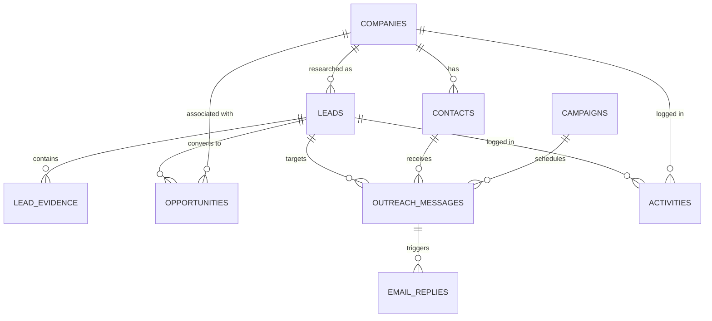

# Queenstown Lead Intelligence - Database Documentation

## Database Overview
The database layer uses Supabase PostgreSQL with UUID primary keys, relational integrity, Row Level Security (RLS), and database-level concurrency controls.

## Entity-Relationship Diagram

## Tables Reference

1. **`companies`**: Discovered target businesses.
   - Primary Key: `id` (UUID)
   - Unique: `(discovery_source, external_provider_id)`
   - Fields: `name`, `website`, `domain`, `industry`, `country`, `city`, `address`, `description`, `discovery_source`, `source_url`, `research_status`, timestamps.

2. **`contacts`**: Identified decision-makers and outreach recipients.
   - Primary Key: `id` (UUID)
   - Foreign Key: `company_id` -> `companies(id)`
   - Unique: `normalized_email`
   - Fields: `full_name`, `email`, `normalized_email`, `job_title`, `verification_status` ('unknown', 'pending', 'valid', 'invalid', 'risky'), `marketing_eligibility_status`.

3. **`leads`**: AI analysis, intelligence, and qualification scores.
   - Foreign Key: `company_id` -> `companies(id)`
   - Fields: `qualification_score` (0-100), `qualification_level` ('high_priority', 'potential_prospect', 'low_priority', 'disqualified'), `score_breakdown` (JSONB), `score_override`, `research_summary`, `business_model`, `identified_opportunity`, `recommended_solution`, `confidence_level`.

4. **`lead_evidence`**: Grounded observations and facts.
   - Foreign Key: `lead_id` -> `leads(id)`
   - Fields: `evidence_type` ('verified_fact', 'observation', 'pain_point', 'website_text'), `title`, `description`, `source_url`, `confidence_score`, `is_verified`.

5. **`opportunities`**: CRM sales pipeline stages.
   - Foreign Keys: `lead_id`, `company_id`
   - 13 Standard Stages: `discovered`, `researched`, `qualified`, `contact_identified`, `outreach_drafted`, `contacted`, `interested`, `meeting_requested`, `meeting_completed`, `proposal_sent`, `negotiation`, `won`, `lost`.
   - Fields: `deal_value`, `currency`, `expected_close_date`, `next_action`, `probability`.

6. **`campaigns`**: Outreach campaigns.
   - Fields: `name`, `description`, `status` ('draft', 'active', 'paused', 'completed'), `target_country`, `target_industry`, `daily_limit`.

7. **`outreach_messages`**: Outbound email sequence items.
   - Foreign Keys: `lead_id`, `contact_id`, `campaign_id`
   - Unique: `(contact_id, sequence_number)`
   - Sequences: 0 (Day 0 Intro), 1 (Day 4 Follow-up), 2 (Day 9 Final Follow-up)
   - Statuses: `draft`, `pending_approval`, `approved`, `processing`, `sent`, `failed`, `bounced`, `cancelled`, `suppressed`.

8. **`email_replies`**: Inbound prospect responses.
   - Foreign Keys: `outreach_message_id`, `contact_id`
   - Classifications: `interested`, `meeting_request`, `needs_info`, `not_interested`, `unsubscribe`, `out_of_office`, `bounce`, `unclear`.

9. **`suppression_list`**: Do-Not-Contact list.
   - Unique: `normalized_email`
   - Fields: `email`, `normalized_email`, `domain`, `reason` ('unsubscribe', 'bounce', 'manual', 'compliance_policy', 'complaint').

10. **`activities`**: Audit trail and event timeline.
    - Fields: `lead_id`, `company_id`, `activity_type`, `title`, `description`, `metadata`, `created_by`.

11. **`system_settings`**: Key-value JSON storage for compliance, kill switch, and integration statuses.

12. **`webhook_events`**: Audit log of external webhooks.

13. **`automation_runs`**: History and telemetry of n8n runs.

14. **`sending_accounts`**: Gmail sending limits and resets.

## Stored Functions & Concurrency

- `claim_eligible_outbound_messages(p_limit INT)`:
  Employs `SELECT FOR UPDATE SKIP LOCKED` inside a transaction.
  Checks global `sending_enabled` switch, evaluates daily limits against today's sent count, verifies contacts against the `suppression_list`, and claims eligible approved messages for processing.
- `cancel_sequence_on_reply(p_contact_id UUID, p_reason TEXT)`:
  Immediately marks any future scheduled sequence follow-ups (sequences 1 & 2) as `'cancelled'`.
- `check_contact_suppression(p_email TEXT)`:
  Returns `true` if either the exact email or domain is on `suppression_list`.
- `record_activity(...)`:
  Inserts a structured audit log entry.
